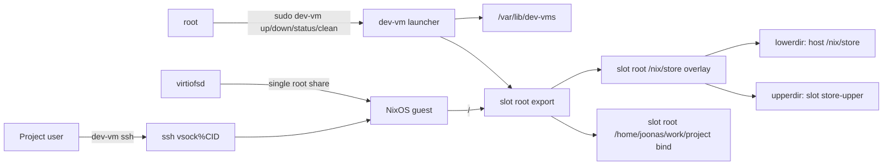
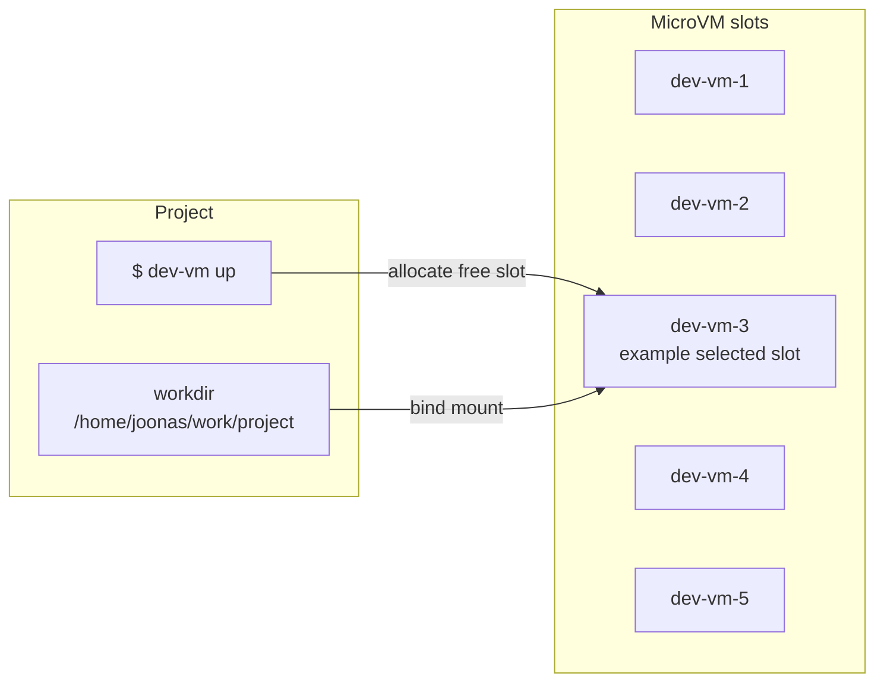
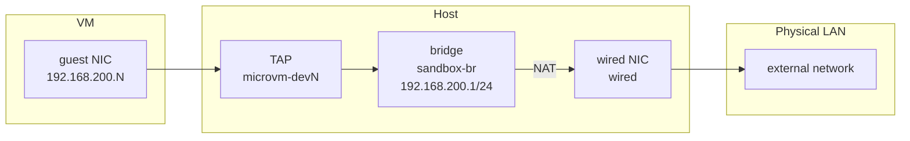
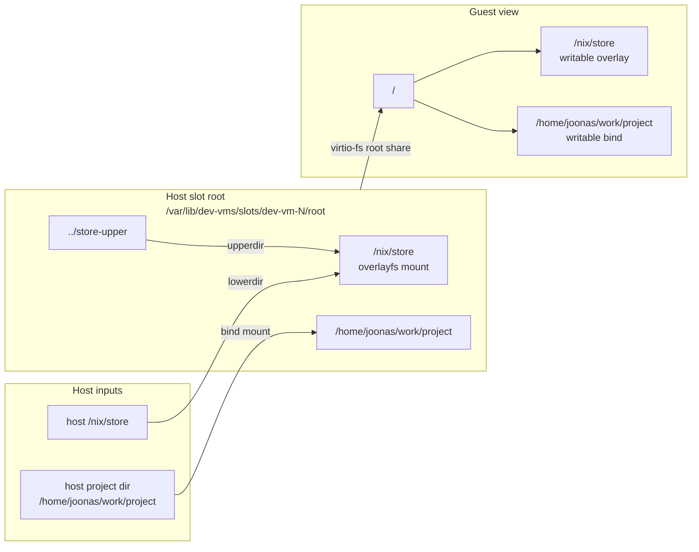
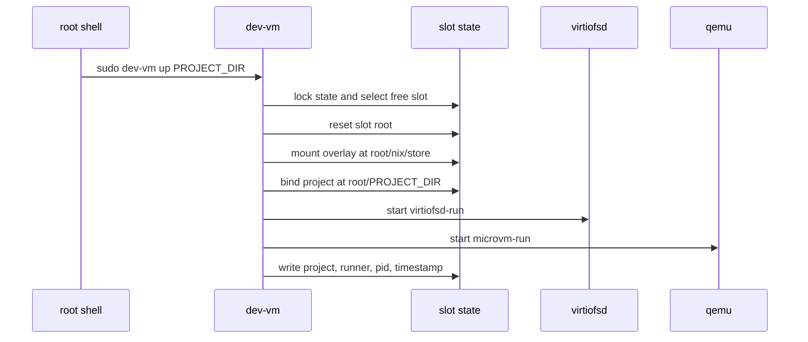

# Development MicroVMs

`dev-vm` runs one of five static microvm.nix slots for a project directory.
The VM identity is the slot; the project is runtime workload data.

## Architecture



Each slot has a fixed NixOS configuration, identity, and resources:

| Slot | IP | TAP | vsock CID |
| --- | --- | --- | --- |
| `dev-vm-1` | `192.168.200.11` | `microvm-dev1` | `11` |
| `dev-vm-2` | `192.168.200.12` | `microvm-dev2` | `12` |
| `dev-vm-3` | `192.168.200.13` | `microvm-dev3` | `13` |
| `dev-vm-4` | `192.168.200.14` | `microvm-dev4` | `14` |
| `dev-vm-5` | `192.168.200.15` | `microvm-dev5` | `15` |

Slot allocation happens at launch time:



The host bridge is `sandbox-br` at `192.168.200.1/24`; NAT uses the host
`wired` interface.



File mounts are prepared inside the slot root before `virtiofsd` starts:



## Commands

Run lifecycle commands as root:

```sh
cd /home/joonas/work/project
sudo dev-vm up
sudo dev-vm status
sudo dev-vm down
```

Run SSH as the project user, not root:

```sh
dev-vm
dev-vm ssh
dev-vm ssh dev-vm-2
dev-vm ssh -- make test
```

Command behavior:

- `dev-vm` with no arguments starts a VM for the current directory if needed,
  then SSHes into it.
- `up [PROJECT_DIR]` allocates a free slot or reuses the slot already assigned
  to the project.
- `down [SLOT_OR_PROJECT]` stops one slot; `down --all` stops all slots.
- `status` lists slots, state, IPs, mount health, and project assignments.
- `ssh` opens an interactive login shell in the assigned project directory.
- `ssh` retries startup connection failures every 2 seconds for up to 30 seconds.
- `ssh -- REMOTE_COMMAND` runs the command without adding an implicit `cd`.
- `clean SLOT` removes per-slot writable store state; the slot must be stopped.

## Launch Flow



The guest receives one virtio-fs root share from:

```text
/var/lib/dev-vms/slots/<slot>/root
```

Inside that exported root, the launcher prepares:

- `/nix/store` as a host-side overlayfs mount.
- the project directory as a writable bind mount at the same visible path.
- static additional bind mounts from the script; currently `/tmp` is
  bind-mounted to guest `/tmp`.

Project paths are normalized to the user-visible `~/work/...` path when that
path resolves to the same physical tree as `/apps/work/...`.

## State And Recovery

State lives under:

```text
/var/lib/dev-vms/
  state.lock
  slots/dev-vm-N/
    project
    runner
    qemu.pid
    virtiofsd.pid
    started-at
    root/
    run/
    store-upper/
    store-work/
```

The lock timeout is 5 seconds by default and can be changed with
`DEV_VM_LOCK_TIMEOUT`. Long-lived QEMU and virtiofsd children close the lock fd,
so `status` and `down` should work while VMs are running.

If a slot has project metadata but no running QEMU process, root commands recover
the stale slot by stopping leftover processes, unmounting slot-root mounts, and
clearing the assignment.

## Alternatives

- https://github.com/apple/container/blob/main/docs/container-machine.md
- https://github.com/herd-core/herd
- https://github.com/losfair/bake
- https://github.com/JanPokorny/locki
- [microsandbox](https://news.ycombinator.com/item?id=44135977)
- [Docker sandboxes](https://news.ycombinator.com/item?id=47042181)
